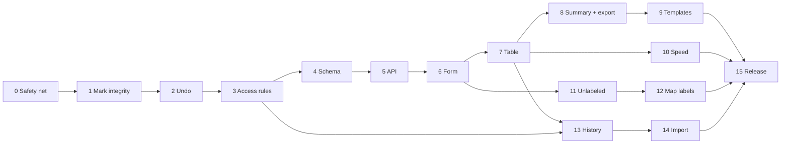

# Lot Register: Roadmap v2

> **Project:** RCD Status Map
> **Stack:** TypeScript · Vite · plain DOM · HTML canvas · Supabase (Auth, Postgres, Storage, Realtime)
> **Replaces:** the first roadmap and its Phase 1 attempt
> **Suggested location in repo:** `docs/lot-register-roadmap.md`
> **Progress log:** `docs/lot-register/progress.md` (updated at the end of every phase)

---

## 1. What changed from the first attempt

| Lesson | What v2 does about it |
|--------|----------------------|
| Migration 013 was applied partway on the live database (`already exists` errors) | A **dev Supabase project** is tested first, every migration runs inside a transaction, and failed runs are never re-run blindly (see [Migration rules](#5-migration-and-database-rules)). |
| The verification SQL failed because project IDs were pasted into user fields, and a `disabled` test user did not exist | Test accounts for all four roles are created in Phase 0, and tests look up identities by role inside each test. |
| Repaint deletes and re-inserts marks, which would break register links | **Foundation phases (1 to 3) fix the existing app first**, before anything new is built on top. |
| Undo only changes local state | Persistent undo is its own phase. |
| Admin-only project and map rules are in the UI but not in RLS | Access rules are fixed in Phase 3, in a way that still lets editors move the legend and edit status categories. |
| Phase numbers like 2a and 2b got confusing | Phases are numbered 0 to 15 and grouped into five milestones. |
| Every phase repeated the same checklists | Shared **Definition of Done** and **Review checklist** sections replace the repetition. |

---

## 2. Overview

Painting a lot today stores only a **status color**. The Lot Register adds a **table of lots** (Phase, Block, Lot, Status) linked to the painted lots, so the team can track lots as data, summarize and export them, and see who changed what.

### Goals

- Label each painted lot with a **Phase / Block / Lot (PBL)** and a status from a side panel.
- Prevent duplicate PBLs in the UI **and** the database.
- Browse, filter, and edit lots in a live table synced across users.
- Summary, **CSV/XLSX export**, and customizable description sentences.
- Track who last edited each lot, with history, within the free-tier limits.

### Non-goals (v1)

- Offline support for the register.
- Register rows for **pins** (only `fill` marks are lots).
- Attachments, comments, or multi-language templates.

---

## 3. Milestones and Phases

| Milestone | Phase | Scope | Changes the database? |
|-----------|-------|-------|----------------------|
| **A. Foundation** (fix what exists) | 0 | Safety net: dev project, test accounts, backups, branch plan | No |
| | 1 | Mark integrity: repaint in place, remove duplicate fills | No |
| | 2 | Persistent undo | No |
| | 3 | Access rules and audit hardening | Yes |
| **B. Core register** | 4 | Register schema and database tests | Yes |
| | 5 | Register API and atomic save | Yes |
| | 6 | Side panel form with duplicate warning | No |
| | 7 | Table view with realtime | No |
| **C. Reporting** | 8 | Summary and CSV/XLSX export | No |
| | 9 | Description templates | Yes |
| **D. Power features** | 10 | Speed tools: auto-increment, bulk status | Yes |
| | 11 | Unlabeled and unmapped indicator | No |
| | 12 | PBL labels on the map | No |
| **E. Audit and release** | 13 | Register history, last edited by, retention | Yes |
| | 14 | CSV import | Yes |
| | 15 | Docs, tests, release | No |

Milestone A is useful on its own: even if you stopped there, the app would be safer than today.



---

## 4. Progress Tracker

Copy this table into `docs/lot-register/progress.md`. Update it at the end of each phase.

| Phase | Name | Dev DB | Prod DB | PR merged |
|-------|------|:------:|:-------:|:---------:|
| 0 | Safety net | n/a | n/a | [ ] |
| 1 | Mark integrity | n/a | n/a | [ ] |
| 2 | Persistent undo | n/a | n/a | [ ] |
| 3 | Access rules and hardening | [ ] | [ ] | [ ] |
| 4 | Register schema | [ ] | [ ] | [ ] |
| 5 | Register API | [ ] | [ ] | [ ] |
| 6 | Side panel form | n/a | n/a | [ ] |
| 7 | Table view | n/a | n/a | [ ] |
| 8 | Summary and export | n/a | n/a | [ ] |
| 9 | Description templates | [ ] | [ ] | [ ] |
| 10 | Speed tools | [ ] | [ ] | [ ] |
| 11 | Unlabeled indicator | n/a | n/a | [ ] |
| 12 | Map labels | n/a | n/a | [ ] |
| 13 | History and retention | [ ] | [ ] | [ ] |
| 14 | CSV import | [ ] | [ ] | [ ] |
| 15 | Docs and release | n/a | n/a | [ ] |

---

## 5. Migration and Database Rules

These rules exist because of the first attempt. They apply to every phase that changes the database.

1. **One purpose per migration file**, numbered with the next free number in `supabase/migrations/` (currently 013). Never edit a migration after it has been applied anywhere; fix forward with a new file.
2. **Wrap each file in `begin;` and `commit;`**, so a failure leaves nothing half-applied.
3. **Apply to the dev project first**, run the phase's verification SQL there, then apply to production **after the PR is merged and before the client code that needs it is deployed**.
4. **If a run errors, do not re-run it.** Run `rollback;`, then inspect what exists (query below) and decide on a fix.
5. **Prefer additive changes** (new tables, new columns, new functions). They are safe to deploy before the client code that uses them.
6. **Security functions** use `set search_path = public`. Use `SECURITY DEFINER` only when necessary, and say why in a comment.
7. **Record each application** (date, environment, result) in `docs/lot-register/progress.md`.

**Inspect what actually exists** (use after any failed or partial run):

```sql
select tablename from pg_tables where schemaname = 'public' order by 1;
select indexname, indexdef from pg_indexes where tablename = 'lot_register';
select tgname from pg_trigger
  where tgrelid = 'public.lot_register'::regclass and not tgisinternal;
select policyname, cmd from pg_policies where tablename = 'lot_register';
select conname, contype from pg_constraint
  where conrelid = 'public.lot_register'::regclass;
```

### Verification test pattern

Every database test looks up its identities by role **inside the test**. Never paste user or project IDs. Save this as `docs/db-tests/_template.sql`.

```sql
begin;
select set_config(
  'request.jwt.claim.sub',
  coalesce((select id::text from public.profiles
            where role = 'editor'::public.app_role order by id limit 1),
           '00000000-0000-0000-0000-000000000000'),
  true);
set local role authenticated;
do $$
begin
  if auth.uid() is null
     or public.get_caller_role() is distinct from 'editor'::public.app_role then
    raise exception 'Setup problem: no editor-role profile found';
  end if;

  -- assertions: raise exception on failure, raise notice 'PASS: ...' on success
end;
$$;
rollback;
```

Use `is distinct from` for role checks, because `<>` against NULL silently passes. The `rollback;` leaves no test data behind.

---

## 6. Definition of Done and Review Checklist

### A phase is done when

- [ ] All of the phase's **Done when** items are checked
- [ ] `npm run typecheck && npm run lint && npm run build` pass and CI is green
- [ ] For database phases: migration applied and verified on **dev**, then applied on **prod** after merge
- [ ] The phase's manual test passed on the Balayan map
- [ ] `docs/lot-register/progress.md` updated
- [ ] PR merged, using the suggested commit style (`feat:`, `fix:`, `docs:`, `chore:`)

### Review the diff for these every time

- Did Copilot change files outside the phase scope? Revert them.
- Is user-entered text rendered with `textContent`, never `innerHTML`?
- Does every API call handle errors, with a message for the user?
- Are permissions enforced in RLS, not only in the UI?
- Is there leftover debug code or unused code?
- Could you explain each new function to someone else? If not, ask Copilot why in a **separate chat**.

---

## 7. Decisions to Confirm Before Starting

Defaults are listed. Change them here before Phase 1, because the prompts follow this table.

| Decision | Default | Why |
|----------|---------|-----|
| Which marks get register rows | `fill` marks only; pins excluded | Pins are annotations |
| PBL storage | Phase, Block, Lot as trimmed, uppercased **text** | Supports values like `12A` |
| Uniqueness | `(project_id, phase, block, lot)` | Same PBL can exist in different projects |
| Mark and row link | `mark_id` unique, nullable, `ON DELETE SET NULL` | Erasing a mark keeps the row (it becomes *unmapped*) |
| Duplicate rule | Conflict only if the existing row is linked to a **different** mark. If unmapped, link it | Makes repainting and import work smoothly |
| Status storage | On the register row and mirrored to the mark by one atomic function | Table and map never disagree |
| Status values | Free text. No database check against `projects.status_config` | It defaults to `{}` and default statuses also live in client code |
| Repaint | Updates the existing mark in place; never delete and re-insert | Keeps mark IDs and history stable |
| Clicking a painted lot | If the selected status differs, update it (with undo toast), then open its panel | Keeps your fast workflow |
| Cancelled form | The painted fill stays and counts as *unlabeled* | Matches current painting behavior |
| Undo | Persistent, based on an inverse action per step | Today's undo is local-only |
| Project and map management | **Admin-only** in RLS. Editors keep moving the legend and editing status categories | Matches your intent; the UI already says admin-only |
| Names shown in history | Display name only, never email | Profiles are admin-readable only |
| History retention | 18 months, purged on a schedule | Protects the 500 MB free-tier database |
| Sticky Phase/Block | Remembered per project in `localStorage` | Survives reloads |

---

## 8. Session Preamble

Paste this **first** in every new Copilot chat, then the phase prompt.

```text
I'm adding a "Lot Register" feature to RCD Status Map (TypeScript, Vite, plain DOM, HTML canvas, Supabase Auth/DB/Storage/Realtime).

Read first: src/main.ts, src/map/, src/api/, src/ui/, supabase/migrations/, docs/lot-register/phase-0-audit.md, docs/lot-register/progress.md.

Rules:
- Follow existing patterns and naming. No new frameworks.
- UI in src/ui/, data access in src/api/, DB changes only as NEW files in supabase/migrations/. Keep edits to src/main.ts minimal.
- Roles are viewer, editor, admin, disabled. RLS enforces permissions; UI role checks are convenience only. Use public.get_caller_role() with explicit app_role casts, as in migration 009.
- Migrations: next free number, begin/commit, "drop policy if exists" before "create policy", set search_path = public on functions. Never edit an applied migration. Do not apply migrations; I apply them myself on the dev project first.
- Verification SQL must look up users and projects by role/name inside each test. Never hardcode ids. Use "is distinct from" for role checks.
- Status values are free text; do not hardcode status names or add a database check against projects.status_config.
- Render user-entered text with textContent, never innerHTML.
- Work ONLY on the phase I name. Do not start later phases.
- When finished, report: files changed, assumptions, results of npm run typecheck / lint / build, and a draft entry for docs/lot-register/progress.md.
- If two meaningfully different approaches exist, ask me before choosing.
```

---

## 9. Phases

### Milestone A: Foundation

#### Phase 0: Safety net

**Goal:** Start clean, protect production data, and make every later phase testable.
**Branch:** `chore/lot-register-phase-0-safety-net`

**Your checklist (manual)**

1. **Archive attempt 1.** Keep the old work reachable but out of the way:
   ```bash
   git tag archive/lot-register-attempt-1 <old-branch-name>
   git switch main && git pull
   git switch -c chore/lot-register-phase-0-safety-net
   ```
   Bring over only what is still valid: the Phase 0 audit document, the CI workflow, and the lint fixes (`git checkout <old-branch-name> -- docs/lot-register/phase-0-audit.md .github/workflows/ci.yml`, and `git cherry-pick <sha>` for the lint-fix commit).
2. **Clean up leftovers from attempt 1 on the live database.** Only if nothing real is in the table:
   ```sql
   select count(*) from public.lot_register;          -- must be 0
   select proname from pg_proc p join pg_namespace n on n.oid = p.pronamespace
     where n.nspname = 'public' order by proname;     -- compare to functions in the old 013 file
   ```
   Then drop the old table (`drop table if exists public.lot_register cascade;`) and any functions that only the old migration 013 created. Re-run the inspection query from section 5 to confirm nothing remains. Do this in a transaction, and stop if anything surprises you.
3. **Create a dev Supabase project** (a second free project; check that your plan still allows two active projects). Apply migrations `001` to `012` and `seed.sql` to it. Give it its own URL and anon key.
4. **Point local development at dev.** Put the dev keys in `.env.development` and the live keys in `.env.production` (Vite loads the right one for `npm run dev` vs `npm run build`). Never commit real keys; commit only `.env.example`.
5. **Create four test accounts on dev**, one per role. Sign up three accounts in the app, then use admin user management to set roles to `editor` and `disabled` (a viewer is the default). Direct SQL updates to `role` are blocked by migration 010, so use the app.
6. **Back up production data.** In the Supabase dashboard, export the `marks` and `projects` tables as CSV and keep them somewhere safe (the free plan does not give you downloadable backups).
7. **GitHub setup:** create milestones A to E, and one issue per phase using the Done-when items as a checklist.

**Prompt (for Copilot)**

```text
PHASE 0. No application code changes.

1. Create docs/lot-register/progress.md with the progress tracker table from the roadmap, plus empty sections "Decisions" and "Execution log".
2. Create docs/db-tests/_template.sql from the verification test pattern in the roadmap, and docs/db-tests/README.md explaining how to run tests in the Supabase SQL editor and the four required test accounts.
3. Create .env.example listing VITE_SUPABASE_URL and VITE_SUPABASE_ANON_KEY with comments about .env.development and .env.production. Make sure real env files are gitignored.
4. Add .github/pull_request_template.md with: phase number, summary, "Done when" checklist, migrations applied (dev / prod), manual test notes.
5. Verify .github/workflows/ci.yml runs typecheck, lint, and build on pull requests.
```

**Done when**
- [ ] Old attempt tagged, leftovers cleaned, inspection query shows no `lot_register` objects on prod
- [ ] Dev project runs the app and has four test accounts (admin, editor, viewer, disabled)
- [ ] Production tables exported
- [ ] Docs, template, and PR template merged; CI green

**Learn:** git tags and cherry-pick, environment files in Vite, why a staging database exists.

---

#### Phase 1: Mark integrity

**Goal:** One fill mark per lot, repainting updates in place, and any existing duplicates cleaned up. This fixes today's behavior and adds no register UI.
**Depends on:** Phase 0
**Branch:** `fix/lot-register-phase-1-mark-integrity`

**Findings that drive this phase:** painting over a lot currently removes the covering marks and adds a **new** mark with a new ID. With overlapping duplicates, the local code removes all of them but persistence deletes only one ID. The hit-test scans marks and rebuilds each mark's pixels from its seed point. Duplicates in live data are possible but unconfirmed.

**Prompt**

```text
PHASE 1: mark integrity. Do not build any register UI.

1. Repaint in place: when a fill click hits an existing fill mark, update that mark's status (same id, set updated_by) through the marks API instead of deleting and re-inserting. Creating a mark on an unpainted lot stays as is.
2. Overlaps: if several fill marks cover the clicked point, keep the most recently updated one, update it, and delete ALL the others in the database. Persist every removal.
3. Persistence consistency: for fill click, erase, and clear, make sure every local removal has an awaited database delete and vice versa. Show failures to the user.
4. Duplicate cleanup tool (admin-only UI, dry-run by default): for the active project, load all fill marks, compute each region with the existing flood-fill logic, group marks that cover the same lot, and show a preview table (group, mark ids, statuses, updated_at, updated_by). Only after explicit confirmation, keep the newest mark per group and delete the rest. Never delete automatically.
5. Explain how the localStorage fallback cache is reconciled with server data on load, and make sure stale cached marks cannot bring deleted duplicates back.
6. No schema changes. If one seems necessary, ask first.
```

**Done when**
- [ ] Repainting keeps the same mark id; `mark_history` shows old to new for that id
- [ ] Two overlapping marks (inserted by hand on dev) resolve to one kept mark; the others are gone from the database after a reload
- [ ] The cleanup dry-run lists duplicate groups for **each of the 6 projects on prod** without changing anything
- [ ] Cleanup only deletes after confirmation, and only after you exported `marks`

**Manual test:** repaint a lot and confirm the id in the Table Editor is unchanged; insert two extra marks with seeds inside one lot via SQL, click it, reload, and confirm one remains.

**Learn:** row identity (update vs delete and re-insert), foreign keys and cascades, dry-run cleanup tools.

---

#### Phase 2: Persistent undo

**Goal:** Undo saves to Supabase, so the map, the table, and other users never disagree. Today undo restores only the in-memory list.
**Depends on:** Phase 1
**Branch:** `fix/lot-register-phase-2-persistent-undo`

**Prompt**

```text
PHASE 2: persistent undo. No register UI.

Context: the current undo snapshots the in-memory mark list. A status change can look reversed locally but is never saved back to Supabase. The handler mainly deletes an added mark.

1. List every undoable action (add, erase, clear, status change, legend move) and what its undo does locally and remotely.
2. Make every undo step persistent: create, delete, or update status through the API so the database and other clients match. Prefer an inverse action per step (status change: mark id, previous status, new status) over diffing whole snapshots. Tell me if you choose otherwise.
3. Before undoing a status change, check that the mark's current status still equals what this user set. If someone else changed it, do not overwrite; show a message.
4. If an action cannot be undone safely (for example Clear), make it persistent or disable its undo and tell the user why. No silent local-only undo.
5. On API failure, roll back the local change and show an error.
6. Export a reusable undoStatusChange(markId, previousStatus) for Phase 6's undo toast. Do not add the toast yet.
7. Ensure this client's own undo does not cause duplicate or flickering updates when the Realtime echo arrives.
```

**Done when**
- [ ] Undoing an add or erase is reflected in Supabase and in a second browser
- [ ] Undoing a status change survives a reload and shows in a second browser
- [ ] If another user changed the status in between, undo refuses and explains
- [ ] No local-only undo path remains

**Manual test (two browsers):** paint, change status, undo in A; confirm B and a reload of A match. Repeat with erase. Change the same lot in B before A undoes, and confirm A is blocked.

**Learn:** snapshot undo vs inverse-action undo, optimistic updates with rollback, Realtime echo.

---

#### Phase 3: Access rules and audit hardening

**Goal:** Make the database enforce what the UI already claims, and make existing history trustworthy.
**Depends on:** Phase 2
**Branch:** `feat/lot-register-phase-3-access-rules`
**Database change:** yes (migration 013)

**Findings that drive this phase:** editors can currently insert, update, and delete projects and upload map images through RLS, although project and map management is meant to be admin-only. But editors **do** legitimately change `legend_x`, `legend_y`, and `status_config`. `marks.updated_by` comes from the client. Editors have an INSERT policy on `mark_history`, so history can be forged. Profiles are readable only by the owner or an admin, so editors cannot see other users' names.

**Prompt**

```text
PHASE 3: access rules and audit hardening. One migration file (next free number), verification SQL in docs/db-tests/.

First, list which columns of projects each role changes in the current UI (expected: editors change legend_x, legend_y, status_config; admins change name and map_url and create/delete projects). Show me before writing SQL.

1. projects: INSERT and DELETE admin-only. UPDATE stays allowed for editors and admins, but add a BEFORE UPDATE trigger that raises if a non-admin changes name or map_url.
2. storage.objects for the maps bucket: INSERT and UPDATE admin-only (DELETE is already admin-only). Keep public read.
3. marks: add a BEFORE INSERT OR UPDATE trigger that sets updated_by = auth.uid() and updated_at = now(), instead of trusting the client.
4. mark_history: drop the "Editors and admins can insert mark history" policy (the SECURITY DEFINER trigger does not need it). Confirm the history trigger still writes rows. Do not change its ON DELETE behavior; explain the trade-off.
5. Add get_display_names(ids uuid[]) returning only id and display_name (never email or role), SECURITY DEFINER with search_path = public, callable by non-disabled users.
6. Verification SQL, one test per role (admin, editor, viewer, disabled) using the dynamic lookup pattern. Cover: editor cannot insert/delete projects or change name/map_url but can change legend_x/legend_y/status_config; editor cannot upload maps; editor cannot insert into mark_history; updated_by cannot be spoofed; display names work for an editor and return no emails; disabled sees nothing.
7. Check the client code for places that rely on editor access to admin-only operations and list them.
```

**Done when**
- [ ] Migration applied and verified on dev, then prod
- [ ] Editors can still move the legend and edit status categories in the app
- [ ] Editors can no longer rename or delete projects or upload maps (in the UI and via the API)
- [ ] Status changes still appear in `mark_history`, and editors cannot write to it

**Learn:** RLS vs column-level rules, triggers that override client values, `SECURITY DEFINER` risks, least privilege.

---

### Milestone B: Core register

#### Phase 4: Register schema

**Goal:** The `lot_register` table, constraints, RLS, and realtime, fully verified before any code uses it.
**Depends on:** Phase 3
**Branch:** `feat/lot-register-phase-4-schema`
**Database change:** yes

**Prompt**

```text
PHASE 4: database schema only. No client code.

Create public.lot_register in one migration (begin/commit):
- id uuid PK default gen_random_uuid()
- project_id uuid not null, FK to projects, on delete cascade
- mark_id uuid null, FK to marks, on delete SET NULL, UNIQUE
- phase, block, lot: text not null, CHECK trimmed length > 0
- status text not null (free text; add a comment on why there is no CHECK against projects.status_config)
- created_by, updated_by: uuid, FK to profiles on delete set null
- created_at, updated_at: timestamptz default now()

Triggers and constraints:
- BEFORE INSERT OR UPDATE trigger that trims and uppercases phase, block, lot.
- UNIQUE (project_id, phase, block, lot) (works because values are normalized by the trigger).
- BEFORE INSERT OR UPDATE trigger that sets created_by (on insert), updated_by = auth.uid(), updated_at = now(). Never trust client values.
- Indexes: (project_id, status) only; the unique constraint already covers (project_id, ...). Do not add extra indexes.

RLS (follow migration 009): SELECT for viewer, editor, admin; INSERT/UPDATE/DELETE for editor, admin. "drop policy if exists" before each create.
Realtime: add the table to the supabase_realtime publication (guard against it already being a member).

Verification SQL in docs/db-tests/phase-4-lot-register.sql, one transaction per test using the dynamic lookup pattern. Cover: normalization, duplicate in one project rejected, same PBL in another project accepted, blank rejected, metadata cannot be spoofed, admin and editor CRUD, viewer read-only, disabled sees nothing, and deleting a mark leaves the row with mark_id null.
```

**Done when**
- [ ] Migration applies cleanly on a fresh dev database (rebuild dev from migrations 001 to 013 to prove it)
- [ ] Every verification test prints PASS and no test leaves data behind
- [ ] The inspection query shows exactly the expected objects
- [ ] Applied to prod after merge

**Learn:** unique constraints, normalization triggers, `ON DELETE SET NULL`, RLS policies per role.

---

#### Phase 5: Register API and atomic save

**Goal:** Typed client functions, plus one database function that updates the register row and the mark together in one transaction.
**Depends on:** Phase 4
**Branch:** `feat/lot-register-phase-5-api`
**Database change:** yes

**Prompt**

```text
PHASE 5: API layer. No UI.

1. Migration: function save_lot(p_project_id, p_mark_id, p_phase, p_block, p_lot, p_status), SECURITY INVOKER, one transaction:
   - normalize inputs; validate p_status is non-empty and reasonably short (no check against status_config),
   - no existing row for the PBL and mark: insert, linked to p_mark_id,
   - existing row for that PBL is unmapped (mark_id null): link it and update its status,
   - existing row for that PBL is linked to a DIFFERENT mark: raise a catchable error that carries the conflicting row id,
   - p_mark_id already has a row: update that row (an edit),
   - update marks.status to match (the existing mark_history trigger will record it).
2. src/api/lotRegister.ts, same style as src/api/marks.ts: listLots(projectId), saveLot(input), updateLotStatus(id, status), deleteLot(id), subscribeLots(projectId, handlers) returning an unsubscribe function, and a DuplicatePblError class carrying the conflicting row.
3. A LotRegisterRow type next to existing API types.
4. Verification SQL for save_lot covering create, edit, link-to-unmapped, conflict, and status mirrored on the mark.
Map Postgres errors to typed errors. Do not swallow errors.
```

**Done when**
- [ ] `saveLot` creates, edits, and links an unmapped row correctly
- [ ] A conflicting PBL throws `DuplicatePblError` with the existing row
- [ ] Row status and mark status always match after a save
- [ ] `subscribeLots` unsubscribes cleanly
- [ ] Applied to dev, verified, then prod

**Learn:** transactions and atomicity, RPC in Supabase, `SECURITY INVOKER` vs `DEFINER`.

---

#### Phase 6: Side panel form

**Goal:** Painting a lot opens a panel where the user enters PBL and status.
**Depends on:** Phases 2 and 5
**Branch:** `feat/lot-register-phase-6-form`

**Prompt**

```text
PHASE 6: side panel form. Create src/ui/lot-panel.ts and styles following existing conventions.

0. Hit-test and repaint: reuse the existing hit-test (scan marks; spans rebuilt from the seed point). Add a label buffer only if click latency on the largest map measures slow. Ignore boundary-pixel clicks. Phase 1 already guarantees one mark per lot and in-place updates; do not reintroduce delete-and-reinsert.
   - Unpainted lot: create the mark and open the blank form.
   - Painted lot, selected status chip differs: update the mark and its row via saveLot, show a 5-second undo toast that calls undoStatusChange from Phase 2, then open the panel in edit mode.
   - Painted lot, same status: change nothing, open the panel in edit mode.
   - Dragging pans and never paints; make sure the end of a pan does not trigger a click.
1. Fields: Phase, Block, Lot, Status. Viewers never see the panel.
2. Phase and Block are sticky per project (localStorage, keyed by project id). Lot clears after each save; focus returns to Lot.
3. Status is pre-filled from the selected status chip; options come from the project's status configuration.
4. Save calls saveLot. Enter saves, Escape cancels. Cancel leaves the fill as an unlabeled lot.
5. On DuplicatePblError keep the panel open, show an inline warning naming the conflicting lot, disable saving until the PBL changes, and offer "Show existing lot" (highlights it on the map). Save nothing until corrected.
6. If the existing row is unmapped, link it without a warning and say so.
7. Accessibility: labels bound to inputs, aria-live for the warning, visible focus.
Keep edits to main.ts and painting code limited to wiring.
```

**Done when**
- [ ] Phase and Block persist between paints and after reload
- [ ] A duplicate PBL shows a warning and blocks saving until corrected
- [ ] An unmapped match links instead of warning
- [ ] Clicking a painted lot opens its panel; repainting with a different status updates it in place, shows the undo toast, and Undo restores it in Supabase
- [ ] The marks table shows one mark per lot after repeated clicking

**Manual test (Balayan):** paint lots 1 to 5 in P1/B2, try a duplicate lot 3 and correct it to 6, reload and confirm P1/B2 are remembered, then repaint a lot with another chip and undo.

**Learn:** event wiring in plain DOM, `aria-live`, optimistic vs confirmed UI.

---

#### Phase 7: Table view

**Goal:** A live table of lots linked to the map.
**Depends on:** Phase 6
**Branch:** `feat/lot-register-phase-7-table`

**Prompt**

```text
PHASE 7: table view. Create src/ui/lot-table.ts, shown next to the form (tab or section).

- Columns: Phase, Block, Lot, Status (colored chip using the project's status colors).
- Natural sort (lot 2 before 10; 12A after 12) by clicking headers.
- Filter by phase, block, status; search box for PBL text.
- Clicking a row highlights that lot on the map and pans/zooms it into view (reuse coordinate helpers in src/map/).
- Editors and admins edit status inline via updateLotStatus; viewers are read-only.
- Subscribe with subscribeLots; changes from other users appear live; unsubscribe on project switch.
- Empty state and row count. Stay responsive at about 2,000 rows (no virtualization unless measured to be needed; tell me).
```

**Done when**
- [ ] Sorting, filtering, and search work together
- [ ] Row click highlights the correct lot
- [ ] Two browsers: an edit in one appears in the other
- [ ] Switching projects does not leak subscriptions

**Learn:** Realtime subscription lifecycle, natural sorting, DOM rendering performance.

---

### Milestone C: Reporting

#### Phase 8: Summary and export

**Depends on:** Phase 7 · **Branch:** `feat/lot-register-phase-8-summary-export`

```text
PHASE 8: summary and export.

1. src/register/summary.ts: pure functions (no DOM): total lots, count and percent per status, breakdown per phase and per block. Handle zero lots.
2. Summary section in the UI, updating live.
3. CSV export: UTF-8 with BOM for Excel, proper quoting, and protection against formula injection (prefix cells starting with = + - @ with an apostrophe).
4. XLSX export: sheets "Lots" and "Summary". Choose a small library, load it with a dynamic import so it stays out of the main bundle, and tell me why you chose it.
5. Buttons: export all, or export the current filter. File name <project>-lots-YYYY-MM-DD.<ext>.
6. If there is no test runner, ask before adding one. The pure summary functions are the best first candidate for tests.
```

**Done when**
- [ ] Summary matches a manual count on Balayan
- [ ] CSV opens in Excel with correct characters; a value like `=cmd` is neutralized
- [ ] XLSX has both sheets; filtered export contains only the filtered rows
- [ ] The main bundle did not grow noticeably (check build output)

**Learn:** dynamic `import()`, CSV injection, unit-testing pure functions.

---

#### Phase 9: Description templates

**Depends on:** Phase 8 · **Branch:** `feat/lot-register-phase-9-templates` · **Database change:** yes

```text
PHASE 9: description templates.

1. Migration: description_templates (id, project_id, name, kind ('lot' | 'summary'), body, created_by, created_at, updated_at). RLS: non-disabled users read; editors and admins write. Add verification SQL.
2. Built-in default templates live in code, not the database. Examples:
   - lot: "Lot {lot} of Block {block}, Phase {phase} is {status}."
   - summary: "As of {date}, {count} of {total} lots in {project} are {status} ({percent}%)."
3. Placeholders: {project} {phase} {block} {lot} {pbl} {status} {count} {total} {percent} {date}. Unknown placeholders are flagged in the editor, never silently dropped.
4. UI: choose a template, see a live preview from real data, edit/add/delete custom templates (editors and admins), Copy button.
5. Render output with textContent. Never evaluate templates as code or HTML. Use a whitelist-based string replace.
6. Stretch, only if simple: {lot_list} collapsing lots into ranges such as "1-5, 7, 9-12".
```

**Done when**
- [ ] Defaults work with no database rows
- [ ] Custom templates persist and sync per project
- [ ] An unknown placeholder shows a visible warning
- [ ] Viewers can generate text but not edit templates

**Learn:** whitelist-based templating, why not `eval`, XSS basics.

---

### Milestone D: Power features

#### Phase 10: Speed tools

**Depends on:** Phase 7 · **Branch:** `feat/lot-register-phase-10-speed` · **Database change:** yes

```text
PHASE 10: speed tools.

1. Auto-increment: after a save, pre-fill Lot with the next free number in the same Phase/Block (skip taken numbers). If the saved lot is non-numeric (e.g. 12A), leave it empty. The user can override. Toggle it off per user.
2. Bulk status change: row checkboxes, select-all for the current filter, shift-click range select, a status dropdown and Apply. Confirm with a dialog showing the count. Implement as ONE database function (all rows or none) that also updates the matching marks. Cap the batch size and explain the cap in the UI. Add verification SQL.
```

**Done when**
- [ ] After saving lot 5 the form shows 6, or 7 if 6 exists
- [ ] A bulk change of 50 rows is a single request and all-or-nothing
- [ ] Map colors update for every affected lot

**Learn:** batch operations, atomic updates, range selection logic.

---

#### Phase 11: Unlabeled and unmapped indicator

**Depends on:** Phase 6 · **Branch:** `feat/lot-register-phase-11-unlabeled`

```text
PHASE 11: unlabeled lots. "Unlabeled" = a fill mark with no register row. "Unmapped" = a register row with no mark.

1. Table: show unlabeled lots as filterable rows marked "Unlabeled", and unmapped rows with a distinct "No map mark" indicator.
2. Map: optional toggle drawing a subtle dashed outline or badge on unlabeled lots (reuse existing canvas layers; do not re-run flood fill unnecessarily).
3. Summary: counts for labeled, unlabeled, and unmapped.
4. Clicking an unlabeled row selects the lot and opens the form with that mark pre-linked.
5. Exports exclude unlabeled lots by default, with a checkbox to include them.
```

**Done when**
- [ ] A cancelled form leaves an unlabeled lot that appears in the table
- [ ] Erasing a labeled mark creates an unmapped row, not data loss
- [ ] Summary counts match what is visible

**Learn:** derived state vs stored state, set difference.

---

#### Phase 12: PBL labels on the map

**Depends on:** Phase 11 · **Branch:** `feat/lot-register-phase-12-map-labels`

```text
PHASE 12: PBL labels on the map.

1. Add a transparent canvas layer above the fills for labels (follow how the fill and pin canvases are created and resized).
2. Label position: a point inside the lot (use the filled pixel span; for concave shapes make sure the point is inside the lot, not just the bounding-box center). Cache positions; recompute only when marks change.
3. Format option: Lot only / Block-Lot / Phase-Block-Lot.
4. Font size scales with zoom; hide labels when a lot is too small to read.
5. Auto contrast: dark or light text depending on the fill color.
6. Toolbar toggle, remembered per user.
7. PNG export includes labels when the toggle is on.
8. Must not slow pan/zoom; measure with about 500 labels and report.
```

**Done when**
- [ ] Labels sit inside their lots, including irregular shapes
- [ ] The PNG export matches the screen
- [ ] Pan and zoom stay smooth with many labels

**Learn:** canvas layering, centroid vs point-in-shape, device pixel ratio.

---

### Milestone E: Audit and release

#### Phase 13: Register history, last edited by, retention

**Depends on:** Phases 3 and 7 · **Branch:** `feat/lot-register-phase-13-history` · **Database change:** yes

```text
PHASE 13: register history.

1. Migration: lot_register_history (id, register_id, project_id, action, old_values jsonb, new_values jsonb, changed_by uuid, changed_at timestamptz). No FK on register_id, so history is not deleted with the row. Index on (register_id) and (changed_at).
2. AFTER INSERT/UPDATE/DELETE trigger on lot_register writing history. changed_by comes from auth.uid() inside the database. Only write a row when OLD and NEW differ, and store only the changed fields. Bulk and import operations produce one history row per lot.
3. RLS: SELECT for editors and admins; no UPDATE or DELETE policies for anyone (append-only); inserts only through the trigger.
4. Table: a "Last edited by / when" column from updated_by and updated_at, with names from get_display_names (Phase 3); "Former user" if missing.
5. History drawer per row: who, when, field-level old to new. Optional "Restore this version" for editors and admins, which applies old values as a NEW update.
6. Retention: function purge_lot_history(retain interval default '18 months'). Do NOT schedule it; give me the pg_cron SQL to run myself.
7. docs/lot-register/storage.md with the table-size query and growth estimates.
8. Verification SQL per role, including that editors cannot alter or delete history.
```

**Done when**
- [ ] Every insert, edit, and delete writes one history row; a no-change save writes none
- [ ] An editor cannot modify or delete history through the API
- [ ] "Last edited by" shows the correct display name (no emails) for an editor
- [ ] `purge_lot_history` removes only rows older than the window
- [ ] Restore creates a new history entry

**Learn:** append-only logs, JSONB diffs, retention, `pg_cron`.

---

#### Phase 14: CSV import

**Depends on:** Phase 13 · **Branch:** `feat/lot-register-phase-14-import` · **Database change:** yes

```text
PHASE 14: CSV import (editors and admins).

1. Pick a CSV file; parse client-side (tell me whether you use a small library or a custom parser, and why). Cap file size and row count.
2. Column mapping step (phase, block, lot, status) with auto-detection of common header names.
3. Validate and PREVIEW before writing anything: counts of new, will-update, duplicate-in-file, blank-field, and invalid-status rows, with a downloadable error report.
4. Imported rows are created unmapped (mark_id null). Existing rows are never overwritten without an explicit checkbox.
5. Commit through a database function in chunks, all-or-nothing per chunk, with the same normalization and uniqueness rules. History rows are created automatically. Add verification SQL.
6. Show progress and a final result summary.
```

**Done when**
- [ ] Preview matches what is committed
- [ ] Invalid rows are reported, never silently skipped
- [ ] Re-importing the same file creates no duplicates
- [ ] Painting a lot with an imported PBL links to it with no duplicate warning

**Learn:** the parse, validate, preview, commit pattern; idempotent imports.

---

#### Phase 15: Docs, tests, release

**Depends on:** Phases 9, 10, 12, 14 · **Branch:** `docs/lot-register-phase-15-release`

```text
PHASE 15: finish and document. No new features.

1. README: feature overview, a list of screenshots/GIFs for me to add, setup (including the dev/prod env files), and a role permissions table for the register.
2. docs/lot-register/: architecture.md (data flow), erd.md (mermaid ERD of the final schema), decisions.md (the decisions table updated to what was actually built), manual-test.md (regression script on the Balayan map, one section per phase).
3. Unit tests for pure logic that exists (summary, natural sort, template engine, CSV escaping, auto-increment), only if a test runner is already agreed.
4. Run typecheck, lint, build and list any warnings.
5. Draft CHANGELOG.md and release notes. Publish nothing.
```

**Done when**
- [ ] A new developer can set up and run the feature from the README
- [ ] The ERD matches the real schema
- [ ] The manual test script passes end to end on dev
- [ ] Release tag created, e.g. `v1.1.0`

---

## 10. Free-Tier Notes

As of 2026, the Supabase free plan includes a 500 MB database and 1 GB of file storage per project, and pauses projects after about a week of inactivity. Confirm current limits at supabase.com/pricing before relying on them.

| Bucket | Holds | Watch for |
|--------|-------|-----------|
| Database (500 MB) | marks, register, history, templates, profiles | History growth, bulk imports, extra indexes |
| File storage (1 GB) | map images in the `maps` bucket | Large PNGs from PDF conversion, replaced maps left behind |

**Rough growth estimate:** a history row is about 0.5 KB. 100 edits per day is about 36,500 rows a year, around 18 MB. Measure your real numbers.

**Check table sizes every few months:**

```sql
select relname as table_name,
       pg_size_pretty(pg_total_relation_size(relid)) as total_size
from pg_catalog.pg_statio_user_tables
order by pg_total_relation_size(relid) desc
limit 10;
```

**Retention job** (after enabling `pg_cron` under Database, Extensions; run it yourself):

```sql
select cron.schedule('purge-old-lot-history', '0 3 * * 0',
  $$ select public.purge_lot_history('18 months') $$);
```

Deleting rows lets Postgres reuse space, but the reported size may not drop right away; the goal is to stop growth. Set a reminder to act at around 350 MB. Compress map images before upload and delete replaced map files through the Storage API. Consider a weekly keep-alive request so the project does not pause.

---

## 11. Risks and Mitigations

| Risk | Mitigation |
|------|-----------|
| A migration is half-applied on prod | Dev project first, transactions, no blind re-runs, inspection query |
| Existing duplicate or orphan marks in live data | Phase 1 fix and dry-run cleanup tool, with a backup first |
| Admin-only rules break legitimate editor actions | Phase 3 lists real editor actions first and keeps legend and status config editable |
| Table and map status drift apart | One atomic save function (Phase 5), persistent undo (Phase 2) |
| Wrong status chip recolors a lot | Undo toast (Phase 6), history and restore (Phase 13) |
| History can be forged | Triggers set identity from `auth.uid()`; the forgeable policy is dropped (Phase 3) |
| Copilot edits outside the phase | Review the diff against scope; one phase per chat |
| Database or storage fills up | Skip no-op history rows, 18-month retention, compress images, check sizes quarterly |
| Free project pauses | Weekly keep-alive request |
| Label rendering slows the map | Cache positions and measure (Phase 12) |
